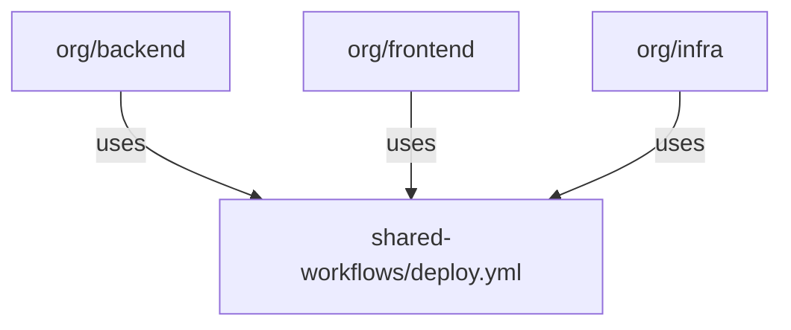

# gh-scripts

Python scripts that scan every repository in a GitHub organization and produce reports (`.md`, `.csv`, `.json`) in the `reports/` folder.

| Script | What it reports |
|---|---|
| `list_org_secrets.py` | Actions/Dependabot secrets and Actions variables per repository |
| `list_org_packages.py` | GitHub Packages (npm, NuGet, Maven, RubyGems, Docker, container) per repository |
| `list_org_cicd.py` | CI/CD tool per repository: GitHub Actions, Jenkins, Harness, or "Not detected" |
| `detect_lfs.py` | Git LFS usage per repository: file count, total size |
| `detect_actions.py` | GitHub Actions usage: actions per workflow, action versions, reusable workflow dependencies with diagrams |
| `detect_terraform_deps.py` | Terraform module dependencies: cross-repository module references, Git sources, versions with Mermaid diagrams |

## Requirements

- Python 3.8+ (standard library only, no `pip install` needed)
- A GitHub token, either:
  - `GITHUB_TOKEN` or `GH_TOKEN` environment variable, or
  - the [GitHub CLI](https://cli.github.com/) logged in (`gh auth login`); the scripts fall back to `gh auth token`

All scripts must stay in the same folder (`list_org_packages.py` and `list_org_cicd.py` import shared code from `list_org_secrets.py`).

## Authentication

```bash
gh auth login
# Add the scopes needed by the scripts
gh auth refresh -h github.com -s read:org,read:packages,admin:repo_hook
export GITHUB_TOKEN=$(gh auth token)
```

| Script | Classic token scopes | Fine-grained token permissions (read) |
|---|---|---|
| `list_org_secrets.py` | `repo`, `read:org` | Secrets, Variables, Environments, Dependabot secrets, Contents |
| `list_org_packages.py` | `read:packages` (+ `repo` for private repos) | Packages |
| `list_org_cicd.py` | `repo`; `admin:repo_hook` for webhook detection | Contents, Webhooks |
| `detect_lfs.py` | `repo`, `read:org` | Contents |

Repositories the token can't read are not skipped silently; the error is recorded in the report.

## Usage

### Secrets and variables

```bash
python3 list_org_secrets.py <org>
python3 list_org_secrets.py <org> --scan-workflows --skip-archived --skip-forks
```

| Option | Description |
|---|---|
| `--scan-workflows` | Also find `secrets.*` / `vars.*` referenced in `.github/workflows/*.yml` and flag the ones not defined |
| `--hide-variable-values` | Do not include Actions variable values in the report |
| `--skip-archived` / `--skip-forks` | Ignore archived / forked repositories |
| `--limit N` | Only process the first N repositories (useful for testing) |

Secret values are never available through the API; only names are reported.

### Packages

```bash
python3 list_org_packages.py <org>
python3 list_org_packages.py <org> --types npm nuget container --with-versions --include-empty-repos
```

| Option | Description |
|---|---|
| `--types` | Package types to list: `npm maven rubygems docker nuget container` (default: all) |
| `--with-versions` | Fetch the latest version/tags of each package (1 extra call per package) |
| `--include-empty-repos` | Also list repositories without packages |

### CI/CD

```bash
python3 list_org_cicd.py <org>
python3 list_org_cicd.py <org> --skip-archived --skip-forks
```

Detection rules (default branch):

| Tool | Detected by |
|---|---|
| GitHub Actions | `.github/workflows/*.yml` / `*.yaml` |
| Jenkins | `Jenkinsfile`, `Jenkinsfile.*`, `*.jenkinsfile` |
| Harness | `.harness/` directory, `*harness*.yml` files, or a repository webhook to `*.harness.io` |

| Option | Description |
|---|---|
| `--no-webhooks` | Skip the Harness webhook check (saves 1 call per repo) |
| `--skip-archived` / `--skip-forks` | Ignore archived / forked repositories |
| `--limit N` | Only process the first N repositories |

### LFS Detection

Detect Git LFS (Large File Storage) usage in repositories. Clones repositories in mirror mode, analyzes LFS objects, and generates reports. **Automatically cleans up temporary files after analysis to preserve storage.**

```bash
python3 detect_lfs.py <org>
python3 detect_lfs.py <org> --max-parallel 5 --skip-archived --skip-forks
```

| Option | Description |
|---|---|
| `--max-parallel N` | Maximum parallel analysis jobs (default: 10) |
| `--skip-archived` | Skip archived repositories |
| `--skip-forks` | Skip forked repositories |
| `--output-dir DIR` | Output directory for reports (default: `./reports`) |
| `--limit N` | Only process first N repositories (useful for testing) |

**Output:** Repositories with LFS usage, file count, and total size.

### GitHub Actions Analysis

Analyze GitHub Actions usage across all repositories, including action versions and reusable workflow dependencies. Generates reports with Mermaid diagrams showing workflow call dependencies between repositories.

```bash
python3 detect_actions.py <org>
python3 detect_actions.py <org> --max-workers=5
```

| Option | Description |
|---|---|
| `--max-workers N` | Number of concurrent repositories to process (default: 10) |

**Features:**
- Extracts all actions from workflow files (`.github/workflows/*.yml`)
- Tracks reusable workflow calls between repositories
- Identifies action versions and usage frequency
- Generates dependency diagrams in Mermaid format
- Reports top 20 most used actions
- Lists all unique actions across the organization

**Output:**
- **JSON:** Raw structured data with all actions and workflow calls
- **CSV:** Tabular format for spreadsheet analysis
- **Markdown:** Human-readable report with statistics, action tables, and Mermaid dependency diagrams

**Diagram Example:** See which repositories call reusable workflows from other repositories:



### Terraform Module Dependencies

Detect and analyze Terraform module dependencies across repositories. Identifies cross-repository module references, Git sources, and versions with dependency diagrams.

```bash
python3 detect_terraform_deps.py <org>
python3 detect_terraform_deps.py <org> --workers=5
```

| Option | Description |
|---|---|
| `--workers N` | Number of concurrent repositories to process (default: 5) |

**Features:**
- Scans for `.tf` files in all repositories
- Parses Terraform `module` blocks and extracts source URLs
- Detects Git-based module sources (GitHub, GitLab, etc.)
- Extracts version/ref information (branch, tag, commit)
- Identifies external module dependencies
- Categorizes modules (Git, Registry, Local)
- Generates dependency analysis and Mermaid diagrams

**Supported Module Source Formats:**
```hcl
# Git HTTPS (detected as external dependency)
source = "git::https://github.com/MyOrg/terraform-modules//vpc?ref=v1.0.0"

# Git SSH (detected as external dependency)
source = "git::ssh://git@github.com/MyOrg/terraform-modules.git//security?ref=main"

# Terraform Registry (not tracked as external dependency)
source = "terraform-aws-modules/vpc/aws"

# Local modules (not tracked as external dependency)
source = "./modules/app"
```

**Output:**
- **JSON:** Structured data with all module definitions and dependencies
- **CSV:** Tabular format for dependency analysis in spreadsheets
- **Markdown:** Human-readable report with statistics and Mermaid dependency diagrams

**Use Cases:**
- Audit which repositories depend on specific modules
- Track module version usage across organization
- Plan module updates and compatibility testing
- Document module architecture and relationships

## Rate limiting

All scripts share the same client, built for large organizations:

- Waits `--min-interval` seconds between requests (default `0.1`) to avoid secondary rate limits.
- When remaining quota drops below `--reserve` (default `50`), sleeps until the rate limit resets.
- Retries on secondary rate limits (`Retry-After` or exponential backoff), 5xx errors, and network errors.
- `Ctrl+C` stops the scan and still writes a partial report.

## Output

Reports are written to `reports/` (change with `--output-dir`):

```
reports/<org>-secrets-<timestamp>.{md,csv,json}
reports/<org>-packages-<timestamp>.{md,csv,json}
reports/<org>-cicd-<timestamp>.{md,csv,json}
```